# DevBot AI — DevOps Engineer's Guide

This guide breaks down every stage of the DevBot AI automated DevOps pipeline in beginner-friendly terms for college demonstrations and technical interviews.

---

## 1. Pipeline Architecture & Flow

```mermaid
flowchart LR
    Dev[Developer Commit] --> Git[GitHub / Git SCM]
    Git -->|Webhook / Polling| Jenkins[Jenkins CI/CD]

    subgraph CI ["Continuous Integration (CI)"]
        J1[Checkout & Validation] --> J2[Install Dependencies]
        J2 --> J3[Run Automated Tests\nBackend & Frontend]
        J3 --> J4[Build Frontend\nProduction Assets]
    end

    subgraph CD ["Continuous Delivery (CD)"]
        J4 --> D1[Docker Multi-Stage Build]
        D1 --> D2[Validate Containers]
        D2 --> D3[Push to Docker Hub]
        D3 --> D4[Deploy to Cloud Web Service]
        D4 --> D5[Verify Health Endpoint]
    end

    Jenkins --> CI
    CI --> CD
```

---

## 2. Stage-by-Stage Breakdown

### Stage 1: Checkout
* **What it does:** Clones the latest commit from your Git repository into the Jenkins workspace.
* **Why it matters:** Guarantees that the pipeline always builds and tests the exact code that was committed, eliminating "it works on my machine" issues.

### Stage 2: Validate Environment
* **What it does:** Checks that the host environment has Node.js, npm, and Docker CLI available.
* **Why it matters:** Detects missing system prerequisites before wasting time running build commands.

### Stage 3: Install Dependencies
* **What it does:** Runs `npm ci` (clean install) inside both `server/` and `client/`.
* **Why it matters:** Unlike `npm install` which can update versions, `npm ci` strictly honors `package-lock.json` so every build is 100% reproducible.

### Stage 4: Run Backend Tests
* **What it does:** Executes Jest and Supertest test suites against the Express backend (`/api/health`, `/api/chat`).
* **Why it matters:** Validates that input sanitation, length checks, error handling, and Gemini SDK integrations work. If any test fails, **the pipeline halts immediately**, preventing broken code from progressing.
* **Mocking:** Gemini API calls are completely mocked during automated testing to avoid incurring costs or relying on external network availability.

### Stage 5: Run Frontend Tests
* **What it does:** Validates frontend test assertions.
* **Why it matters:** Prevents syntax errors, broken imports, or missing components from being compiled into the user interface.

### Stage 6: Build Frontend
* **What it does:** Runs `npm run build` using Vite to compile React JSX and modern CSS into optimized HTML, CSS, and JS bundles inside `client/dist/`.
* **Why it matters:** Tests whether the production bundle compiles cleanly before Docker packaging.

### Stage 7: Build Docker Images
* **What it does:** Builds container images for both frontend and backend:
  * Backend: Lightweight Node.js 20 Alpine image running as non-root user `node`.
  * Frontend: Multi-stage Dockerfile where Stage 1 builds React and Stage 2 copies the static files into Nginx Alpine.
  * Tags images with both the Jenkins build number (`:4`) and `:latest`.
* **Why it matters:** Container images package the application with its exact OS dependencies, guaranteeing identical behavior across development, testing, and production.

### Stage 8: Validate Container Configuration
* **What it does:** Tests the Docker Compose specification (`docker compose config`) to ensure all network bridges, port mappings, and environment variables are valid.

### Stage 9: Push Images to Docker Hub
* **What it does:** Authenticates to Docker Hub using Jenkins credentials and pushes the tagged images.
* **Why it matters:** Docker Hub acts as our centralized Container Registry. The cloud deployment platform pulls verified images directly from this registry.

### Stage 10: Deploy to Cloud
* **What it does:** Triggers a webhook deployment to the cloud provider (e.g. Render / Cloud Web Service).
* **Why it matters:** Automates Continuous Deployment (CD) so updates reach public users without manual SSH or manual file uploads.

### Stage 11: Verify Deployment Health
* **What it does:** Sends an automated HTTP `GET` request to `/api/health` on the deployed service to confirm zero-downtime startup.

---

## 3. DevOps Principles Demonstrated

1. **Shift-Left Security & Testing:** Bugs and security regressions are caught early in the development lifecycle before code is packaged or deployed.
2. **Infrastructure as Code (IaC) & Containerization:** Dockerfiles and `docker-compose.yml` specify the exact runtime environment.
3. **Fail-Fast Pipeline:** If tests fail in Stage 4, stages 5 through 11 never run.
4. **Secret Isolation:** Environment variables (`GEMINI_API_KEY`, passwords) are never committed to version control or hardcoded in Dockerfiles.
