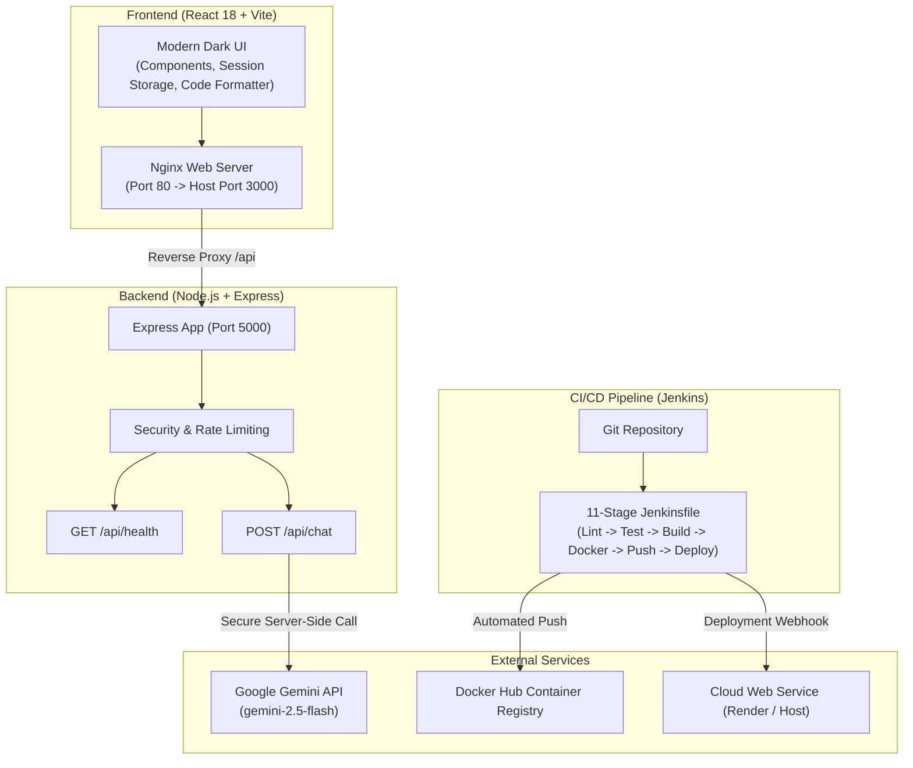

# DevBot AI — Gemini-Powered Chatbot with End-to-End DevOps Automation

[](https://www.jenkins.io/)
[](https://www.docker.com/)
[](https://reactjs.org/)
[](https://nodejs.org/)
[](https://aistudio.google.com/)

DevBot AI is an enterprise-grade AI chatbot web application powered by Google Gemini, engineered from the ground up with a comprehensive DevOps automation pipeline. Designed for a college DevOps Expo, it showcases full-stack application development, automated testing, multi-stage Docker containerization, Jenkins CI/CD, image registry distribution, and cloud deployment.

---

## 1. Problem Statement & Objectives

While AI assistants and LLMs are revolutionizing productivity, delivering AI software reliably requires rigorous engineering practices:
- **Preventing Production Regressions:** Unvetted code or configuration changes can break user interactions or introduce vulnerabilities.
- **Environment Inconsistency:** Applications that work on a developer's laptop often encounter dependency mismatch in production ("works on my machine" syndrome).
- **Security & Secret Exposure:** API keys and credentials can be accidentally leaked to client-side bundles or public repositories.

### Key Objectives
1. Build a responsive, dark-themed AI chatbot using React 18, Vite, and Express.js.
2. Securely integrate Google Gemini API via official SDKs without exposing credentials in client bundles.
3. Containerize both frontend and backend using multi-stage Docker builds and Nginx reverse proxy.
4. Automate testing, image building, security checks, and deployment with an 11-stage Jenkins Declarative Pipeline.
5. Provide continuous health verification, structured logging, and observability.

---

## 2. Architecture Overview



---

## 3. Technology Stack

* **Frontend:** React 18, Vite 6, Lucide Icons, Custom Responsive CSS (Dark Theme).
* **Backend:** Node.js (v20+ / v24), Express.js 4, `express-rate-limit`, CORS.
* **AI Model:** Google Gemini API via official `@google/genai` SDK (`gemini-2.5-flash`).
* **Containerization:** Docker, Docker Compose, Multi-stage builds, Nginx Alpine, Node Alpine.
* **CI/CD Pipeline:** Jenkins (Declarative Pipeline `Jenkinsfile`), Git, GitHub.
* **Testing:** Jest, Supertest (100% mocked AI API calls for fast, offline verification).
* **Container Registry:** Docker Hub.
* **Cloud Hosting:** Cloud Web Service / Render.

---

## 4. Application Features

* **Intelligent DevOps Chat:** Answers queries on Docker, Jenkins, Kubernetes, Cloud, and full-stack development.
* **High-Contrast Dark UI:** Custom responsive styling designed for technical expo presentations.
* **Code Highlighting & Copy Buttons:** Formats multi-line code blocks with language labels and instant copy-to-clipboard functionality.
* **Session Conversation History:** Multi-session chat navigation stored within browser session storage.
* **Smart Prompt Chips:** Quick-start suggestions for common DevOps topics.
* **Live Health Monitoring:** Visual indicator pill polling `/api/health` continuously.
* **Defensive Backend:** Rate limiting (60 req/15min), strict request size and character bounds (4000 char max), and sanitized error responses.

---

## 5. Prerequisites

Before running the project locally, verify you have the following installed:
* **Node.js:** v20.x or higher (`node -v`)
* **npm:** v10.x or higher (`npm -v`)
* **Git:** v2.x or higher (`git --version`)
* **Docker Desktop:** Installed and running (`docker --version`)
* **Google Gemini API Key:** Obtainable free from [Google AI Studio](https://aistudio.google.com/)

---

## 6. Installation & Local Development

### 1. Clone the Repository
```powershell
git clone <your-repository-url>
cd DevBot
```

### 2. Configure Environment Variables
Copy `.env.example` to `.env` in the project root:
```powershell
Copy-Item .env.example .env
```
Open `.env` in an editor and insert your Gemini API Key:
```env
PORT=5000
NODE_ENV=development
GEMINI_API_KEY=your_actual_api_key_here
GEMINI_MODEL=gemini-2.5-flash
CLIENT_ORIGIN=http://localhost:3000
```

### 3. Install Dependencies
```powershell
# Install backend dependencies
cd server
npm install

# Install frontend dependencies
cd ../client
npm install
```

### 4. Run Development Servers
Open two terminal windows:

* **Terminal 1 (Backend):**
  ```powershell
  cd server
  npm run dev
  ```
  Backend starts at `http://localhost:5000`.

* **Terminal 2 (Frontend):**
  ```powershell
  cd client
  npm run dev
  ```
  Frontend starts at `http://localhost:3000`.

---

## 7. Running with Docker Compose (Production Setup)

Docker Compose starts both the backend and frontend in isolated containers connected over a private bridge network.

```powershell
# 1. Start Docker Desktop on Windows

# 2. Build and start containers
docker compose up --build -d

# 3. View status of running containers
docker compose ps

# 4. View real-time container logs
docker compose logs -f

# 5. Stop containers cleanly
docker compose down
```

* **Frontend:** Accessible at `http://localhost:3000`
* **Backend Health Check:** `http://localhost:5000/api/health`

---

## 8. Automated Testing

All automated tests use mocks for external Gemini API calls. Tests run offline without burning API quota or failing due to network blips.

```powershell
# Run backend test suite
cd server
npm test

# Run tests with code coverage report
npm test -- --coverage
```

### What is Tested:
1. `GET /api/health` returns status 200 and does NOT leak API keys.
2. `POST /api/chat` rejects empty payloads (400).
3. `POST /api/chat` rejects non-string payloads (400).
4. `POST /api/chat` rejects oversized messages > 4000 chars (400).
5. `POST /api/chat` returns 405 Method Not Allowed on invalid verbs.
6. Mock Gemini generation returns formatted 200 answers.
7. Upstream timeouts and rate limits return sanitized error messages.

---

## 9. Jenkins CI/CD Pipeline

The included `Jenkinsfile` defines an 11-stage Declarative Pipeline:

| Stage | Name | Description |
| :---: | :--- | :--- |
| **1** | **Checkout** | Clones latest source code from Git repository. |
| **2** | **Validate Environment** | Confirms Node.js, npm, and Docker tools exist. |
| **3** | **Install Dependencies** | Runs clean install (`npm ci`) in client and server. |
| **4** | **Run Backend Tests** | Executes Jest + Supertest test suites. |
| **5** | **Run Frontend Tests** | Validates frontend components. |
| **6** | **Build Frontend** | Compiles production bundle with Vite. |
| **7** | **Build Docker Images** | Builds multi-stage Docker images tagged with build number and `latest`. |
| **8** | **Validate Containers** | Validates Docker Compose network and configuration. |
| **9** | **Push to Docker Hub** | Pushes images using Jenkins credentials store. |
| **10** | **Deploy to Cloud** | Triggers cloud deployment webhook. |
| **11** | **Verify Health** | Confirms successful deployment and outputs build summary. |

---

## 10. Security & Best Practices

1. **Strict Secret Isolation:** `GEMINI_API_KEY` is loaded exclusively into backend memory. It is excluded from Git via `.gitignore`.
2. **Least Privilege Container:** The backend Dockerfile switches to `USER node` instead of running as `root`.
3. **Multi-Stage Builds:** The frontend Dockerfile discards build tools and Node.js runtime, retaining only lightweight static assets inside Nginx Alpine.
4. **Input Sanitization & Rate Limiting:** All incoming chat payloads are bounded in size, and client IPs are rate-limited.
5. **No Stack Traces in Production:** Server errors return safe generic messages without exposing system internals.

---

## 11. Expo Demonstration & Guides

For a minute-by-minute presentation plan, check:
* **[DEMO_GUIDE.md](file:///d:/DevBot/DEMO_GUIDE.md):** 5-minute pitch script, commands, and anticipated judge questions.
* **[DEVOPS_GUIDE.md](file:///d:/DevBot/DEVOPS_GUIDE.md):** Deep-dive explanation of all CI/CD concepts.

